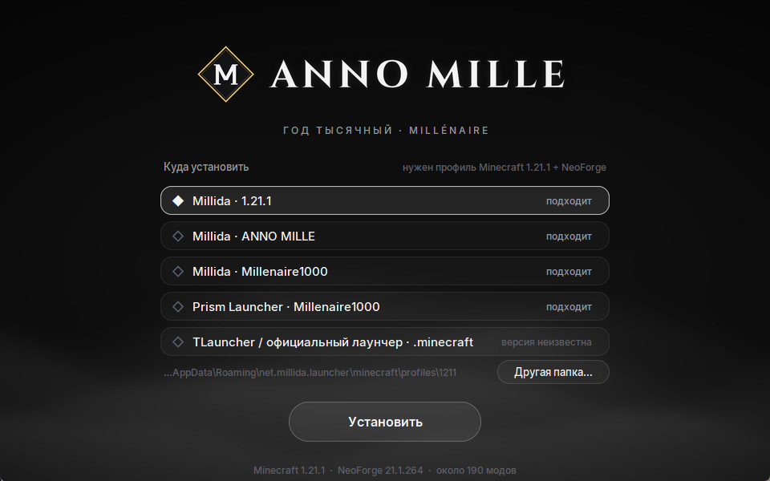

<p align="center">
  
</p>

<p align="center">
  <b>Minecraft 1.21.1 · NeoForge 21.1.264 · 199 модов · одиночная игра и игра с друзьями</b><br>
  <a href="#установка">Установка</a> ·
  <a href="docs/HOTKEYS.md">Клавиши</a> ·
  <a href="docs/MODLIST.md">Список модов</a> ·
  <a href="#если-что-то-пошло-не-так">Если что-то пошло не так</a> ·
  <a href="#контакты">Контакты</a>
</p>

---

## О сборке

Anno Mille («год тысячный» по-латыни) собрана вокруг мода [Millénaire](https://www.millenaire.org/ru). В мире живут деревни XI века: норманны, византийцы, сельджуки, индийцы, японцы, майя и инуиты. Жители работают, строят дома, торгуют и иногда просят о помощи. Если заслужишь их доверие, сможешь основать собственную деревню.

Всё остальное в сборке подобрано под эту эпоху. Здесь нет техники, огнестрела и яркой магии. Есть кольчуги и ламеллярные доспехи, корабли и телеги, холодные ночи и дорогая сталь.

Сборка не для лёгкой прогулки. Дерево не добыть кулаком, без тёплой одежды в горах замёрзнешь, грязная вода травит, а монстры со временем становятся сильнее. Прокачка рассчитана примерно на двести часов игры.

## Что внутри

<p align="center">
  
  
</p>

**Деревни Millénaire.** Семь культур, у каждой свои дома, товары и ремёсла. Репутация растёт от торговли, заданий и пожертвований. С высокой репутацией вождь учит тебя местным культурам и разрешает основать свою деревню.

**Выживание всерьёз.** Температура тела (Cold Sweat), жажда (Thirst Was Taken), разнообразие еды (Spice of Life), смена сезонов (Serene Seasons). Первые инструменты делаются из камней, волокна и кремня (Survivalist Essentials), а деревья рубятся постепенно (TreeChop).

**Оружие и броня XI века.** Epic Knights, Slavic Armory, Spartan Weaponry и Samurai Dynasty. Удары с замахом и комбо добавляет Better Combat.

**Мир.** Рельеф Tectonic, подземелья YUNG's, таверны, руины, замки и лагеря разбойников. Ванильные деревни отключены, живут только поселения Millénaire.

**Дорога и быт.** Корабли Small Ships, телеги и плуг AstikorCarts, лошади SWEM, рюкзак, кухня Farmer's Delight, пивоварня, винодельня, пекарня, мебель и десятки строительных блоков.

**Атмосфера.** Шейдеры Complementary Reimagined, звуки природы, эхо в пещерах, падающие листья, дождь из частиц.

**Свой интерфейс.** Тёмные окна, кнопки и меню в одном стиле, живой фон в главном меню, свои надписи под логотипом, иконка и название окна «Anno Mille». Интерфейс включается сам при первом запуске и не слетает, даже если лаунчер сбросит настройки.

**На русском.** Кроме перевода самих модов, сборка добавляет больше 16 000 своих строк: названия блоков и предметов, подсказки, меню, настройки модов, достижения.

## Квесты

<p align="center">
  
</p>

145 квестов в 10 главах, книга открывается клавишей <kbd>Ё</kbd>. «Летопись» проведёт от первого костра до собственной деревни, а остальные главы открываются по ходу игры: «Суровый край», «Жизнь деревень», «Семь народов», «Ремесло и очаг», «Кузня и сталь», «Зодчество», «Пути и паруса», «За горизонтом» и «Ратные подвиги».

В каждом квесте написано, что сделать и зачем. У каждого из семи народов свои задания, награды и путь к званию вождя. Рецепты сверены с самими модами, а все строения, биомы и мобы из заданий проверены на существование.

## Навыки

<p align="center">
  
</p>

Окно навыков открывается клавишей <kbd>P</kbd>. Деревьев четыре, и каждое качается своим делом. Воин растёт от побед над врагами, Лесник и следопыт от рубки леса и рыбалки, Рудокоп и мастер от добычи руды и плавки, Хозяин от готовки и ремесла.

Прибавки маленькие, от одного до трёх процентов за навык. В каждом дереве 40 навыков и только 35 уровней, поэтому всё не возьмёшь. На концах веток стоят мастерства, и в каждом дереве можно выбрать только одно из них.

## Системные требования

| | Минимум | Рекомендуется |
|---|---|---|
| Процессор | 4 ядра, 3,5 ГГц | 6–8 ядер (Ryzen 5 5600 и новее) |
| Видеокарта | GTX 1660 / RX 5600 (без шейдеров) | RTX 3060 / RX 6700 XT и новее |
| Оперативная память | 16 ГБ (игре выделить 6 ГБ) | 32 ГБ (игре выделить 8 ГБ) |
| Место на диске | 3 ГБ | 5 ГБ на SSD |

На Ryzen 7 7800X3D и RTX 5070 в 1080p с шейдерами держится 165 кадров в секунду.

## Установка

Понадобится только установщик [**AnnoMille-Setup.exe**](../../releases/latest). Python и другие программы ставить не нужно.

<p align="center"></p>

Рядом с каждым профилем видно, подходит ли он: «подходит» значит Minecraft 1.21.1 с NeoForge, неподходящие профили стоят внизу и подписаны красным.

1. **Создай профиль в своём лаунчере.** Версия Minecraft **1.21.1**, загрузчик **NeoForge 21.1.264**. Запусти профиль один раз до главного меню и закрой игру. Подойдёт любой лаунчер: TLauncher, Millida, Prism, Modrinth App, CurseForge, официальный.
2. **Запусти `AnnoMille-Setup.exe`.** Он сам найдёт профили установленных лаунчеров. Выбери нужный и нажми «Установить». Если профиля нет в списке, нажми «Другая папка…» и укажи папку, где лежат `mods` и `config`.
3. **Подожди 5–15 минут.** Установщик скачает около 640 МБ модов со страниц их авторов и проверит каждый файл. Потом разложит настройки, квесты, интерфейс и навыки.
4. **Выдели игре 8 ГБ памяти** в настройках профиля и запускай.

Если Windows покажет «Система Windows защитила ваш компьютер», нажми «Подробнее» → «Выполнить в любом случае». Так бывает с любой программой без платной цифровой подписи. Установщик ничего не меняет за пределами выбранной папки игры.

<details>
<summary>Prism Launcher, Modrinth App, ATLauncher: установка через .mrpack</summary>

Можно импортировать файл [`Anno-Mille-1.3.1.mrpack`](../../releases/latest). В Prism это «Добавить экземпляр → Импорт», в Modrinth App «+ → Import from file». Лаунчер сам создаст профиль с NeoForge и скачает 201 файл.

Несколько модов авторы выкладывают только на CurseForge и на сайте Millénaire, поэтому в `.mrpack` их нет. Это сам Millénaire, FTB Quests, FTB Chunks, лошади SWEM, Cinematic Interactions и текстуры Excalibur. После импорта запусти `AnnoMille-Setup.exe` и выбери этот профиль: установщик докачает недостающее, а уже скачанное пропустит.
</details>

<details>
<summary>Без exe: установка скриптом Python</summary>

Скачай репозиторий (**Code → Download ZIP**), поставь [Python 3.10+](https://www.python.org/downloads/) и библиотеку `pip install pillow`, затем выполни в папке репозитория:

```
python tools/install.py "путь\к\папке\игры"
```
</details>

### Первый мир

Создай новый мир на сложности «Сложная». В старых мирах не будет камешков и веточек на земле, а деревни Millénaire появляются только в новых, ещё не исследованных землях.

### Игра с друзьями

Сервер не нужен, мир открывается прямо с твоего компьютера.

1. Друг ставит Anno Mille тем же установщиком. Моды и их версии должны совпадать, иначе он не подключится.
2. Ты заходишь в свой мир, жмёшь <kbd>Esc</kbd> → «Открыть для сети». В этом окне впиши постоянный порт, например `25565`. Если вы с другом играете через разные лаунчеры или без лицензии, в пункте «Проверка лицензии» **выбери «Отключить»**: иначе сервер не пустит друга и напишет «Недействительная сессия».
3. Если друг в другой сети, пробрось этот порт (TCP) на роутере или в программе вроде Porthole, playit.gg, Radmin VPN или ZeroTier.
4. Друг выбирает «Сетевая игра» → «По адресу» и вводит адрес с портом, который выдала программа (или `твой-IP:порт`).
5. Перед тем как открыть мир для сети, перезапусти игру, если до этого уже заходил в другой мир. Иначе друга может выкинуть с ошибкой `set_equipment`.

Чтобы делить квесты и захваченные чанки, вступите в одну команду FTB Teams (кнопка команды в окне инвентаря).

## Что нового в 1.3.1

- Деревни Millénaire теперь появляются не ближе 1000 блоков от точки появления (было 3000): первую деревню можно найти за несколько минут пути.

## Что нового в 1.3.0

- Книга квестов по порядку: главы открываются одна за другой, когда в предыдущей выполнена половина квестов. Закрытые главы видны с замком. Названия глав и квестов простыми словами, квесты расставлены деревом слева направо. Починены пропадавшие названия и связи.
- Моды связаны между собой: культуры и еда Millénaire подходят в рецепты кухонных модов, мех и шкуры утепляют одежду Cold Sweat, общие металлы и ткани для брони. Полный список — в [docs/LINKS.md](docs/LINKS.md).
- Тело вышедшего игрока: когда игрок выходит с сервера или из LAN-мира, на его месте остаётся тело со всеми вещами. Его можно обыскать, забрать или положить вещи, а можно убить — тогда вещи выпадут. Когда игрок вернётся, оставшиеся вещи вернутся к нему.
- В уже начатых мирах у части квестов сбросится выполнение: раньше их номера были случайными. Лучше начать новый мир.

## Что нового в 1.2.2

- Async: обработка существ идёт на нескольких ядрах процессора, меньше лагов там, где много мобов и жителей. Мод экспериментальный; если жители или животные ведут себя странно, его можно выключить в игре командой `/async config toggle`.

## Что нового в 1.2.1

- Исправлен вылет, когда смотришь на бак, котёл или другой блок с жидкостью (Thirst Was Taken и Jade).

## Что нового в 1.2.0

- Millénaire 9.0.3. Деревня теперь находка: каждый тип деревни встречается в мире не больше одного раза и не ближе 3000 блоков от точки появления, а территория у деревень максимальная, какую держит мод.
- Репутацию в деревнях нужно зарабатывать в 5 раз дольше.
- Свой загрузочный экран в стиле меню: живой фон, логотип со свечением и бегущими искрами. Тёмным стало и самое первое окно загрузки NeoForge.
- Новые моды: Cinematic Interactions (верстак, печь, наковальня и другие блоки открываются анимированными сценами), Punchy (анимации рук), Picture Mode (<kbd>F4</kbd>), Better Clouds, Chat Animation, 3D Skin Layers, InvMove (можно ходить с открытым инвентарём), Hide Item Frame (<kbd>F7</kbd>). Подсказки к предметам теперь от EnhancedTooltips: превью брони и мобов.
- Меньше фризов: установщик выделяет игре 8 ГБ памяти и настраивает сборку мусора (Millida и Prism), ускорена генерация мира (NoisiumForked), деревни держат меньше загруженных чанков.
- Установщик сам создаёт профиль в Millida, KLauncher, TLauncher, официальном лаунчере и Prism: выбери «Новый профиль» и лаунчер прямо в окне.

## Что нового в 1.1.1

- Деревни Millénaire встречаются в два раза реже: между деревнями не меньше 1000 блоков.
- Мобы и животные больше не ходят с перепутанными текстурами: Excalibur теперь меняет только блоки и предметы, а мобов рисует Fresh Animations.
- Исправлены ещё две анимации мобов, которые не загружались.
- В окне «Открыть для сети» можно выбрать порт и выключить проверку лицензии (мод LAN World Plug-n-Play).
- Установщик не запускается, пока открыта игра. Раньше игра при выходе записывала поверх новых квестов старые, и в книге появлялись «Безымянные» задания.

## Что нового в 1.1.0

- Тёмный интерфейс включается сам при первом запуске и больше не слетает.
- Клавиши сборки стали клавишами по умолчанию: квесты всегда на <kbd>Ё</kbd>.
- Иконка и название окна «Anno Mille», тёмный экран загрузки с логотипом.
- Больше 16 000 строк перевода модов на русский.
- Квесты семи народов переписаны, главы переименованы, у заданий понятные названия вместо «Продвижение».
- Свои надписи под логотипом в главном меню.
- Исправлены рецепт пиццы, добыча статуй Samurai Dynasty и анимации мобов Born in Chaos.
- Для новых игроков дальность прорисовки 16, а симуляции 10: так меньше подтормаживаний.
- Новый установщик в стиле главного меню.

## Если что-то пошло не так

**Интерфейс остался серым или квесты не открываются на Ё.** Проверь, что запускаешь именно тот профиль, куда ставил сборку: в Millida легко случайно выбрать стандартный профиль другой версии. Если профиль верный, запусти установщик ещё раз.

**Игра вылетает при запуске.** Мод Crash Assistant покажет окно с причиной вылета. Чаще всего виновата нехватка памяти: проверь, что игре выделено 8 ГБ. Ещё одна причина: в папке `mods` лежат две версии одного мода. Оставь одну.

**Лаунчер пишет «конфликт» или «несовместимость».** Например: More Culling и Sodium, Supplementaries и Farmer's Delight, Pufferfish's Attributes и Pufferfish's Skills. Это ложная тревога. Моды предупреждают только о несовместимости со старыми версиями соседей, а в сборке стоят новые. Некоторые лаунчеры показывают предупреждение, не сравнивая версии. Игра запустится нормально.

**Мало кадров.** Выключи шейдеры клавишей <kbd>K</kbd> или выбери пак полегче клавишей <kbd>O</kbd>, например BSL. Дальность прорисовки 12 чанков вместо 16 тоже сильно помогает, а дальность симуляции больше 10 сильно грузит игру из-за деревень.

**Не видно деревень.** Деревни появляются не ближе 250–500 блоков от точки появления и только в новых землях. Клавиша <kbd>V</kbd> показывает уже найденные.

**Названия квестов на английском или «Безымянный».** Проверь, что в папке `config/ftbquests/quests/lang` лежат файлы `ru_ru.snbt` и `en_us.snbt`. Если нет, запусти установщик ещё раз.

**Антивирус ругается на установщик.** Это ложное срабатывание: так антивирусы реагируют на программы, собранные из Python в один файл. Исходный код установщика лежит в `tools/installer_gui.py` и `tools/install.py`, его можно проверить или запустить скриптом без exe.

## Для тех, кто хочет поменять сборку

Всё, что сделано специально для Anno Mille, лежит в папке `tools` и собирается скриптами на Python.

| Что | Файл |
|---|---|
| Квесты: тексты и задания | `tools/quests/build_quests.py`, `tools/quests/texts_h.json` |
| Деревья навыков | `tools/ui/skills.py` |
| Тёмный интерфейс | `tools/ui/build.py` |
| Русский перевод модов | `tools/ui/translations/` |
| Надписи в главном меню | `tools/ui/splashes.txt` |
| Клавиши и настройки по умолчанию | `tools/build_defaults.py` |
| Исправления рецептов и добычи модов | `tools/minimod_fixes/` |
| Живой фон главного меню | `tools/ui/bg.py` |
| Мини-мод сборки (без ванильных деревень, теги структур, навыки) | `tools/build_minimod.py` |
| Список модов с точными версиями | `tools/manifest.txt` |
| Сборка `.mrpack` | `tools/build_mrpack.py` |
| Установщик и сборка exe | `tools/install.py`, `tools/installer_gui.py`, `tools/build_exe.py` |

## Благодарности

Сборка держится на чужом труде. Спасибо авторам всех модов из [списка](docs/MODLIST.md), и отдельно Kinniken и команде Millénaire за мир, ради которого всё затевалось. Файлы модов здесь не хранятся: установщик скачивает их со страниц авторов, поэтому скачивания засчитываются им.

## Лицензия

Собственные файлы сборки (квесты, настройки, интерфейс, скрипты) распространяются по лицензии [MIT](LICENSE). Моды, ресурспаки и шейдеры принадлежат их авторам и распространяются на их условиях.

## Контакты

- Telegram: @holidesuSXC
- Discord: h0lydesu
- Почта: holidesusxc@gmail.com
- Баги и предложения: [Issues](../../issues)
