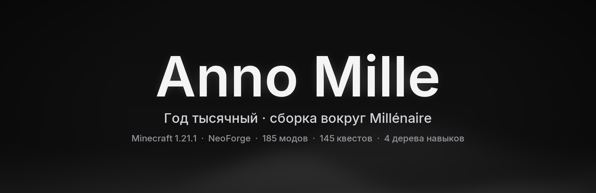
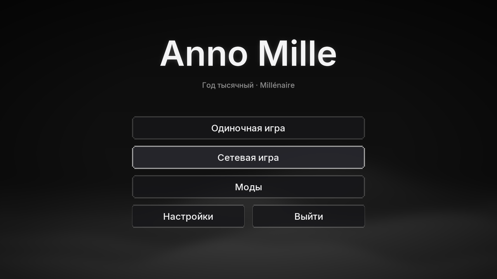
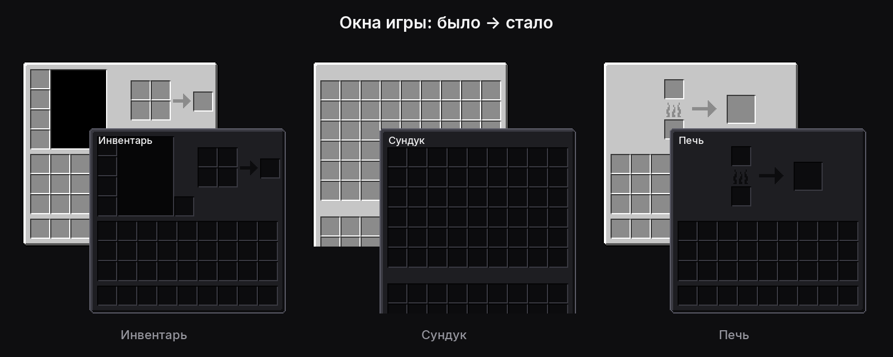
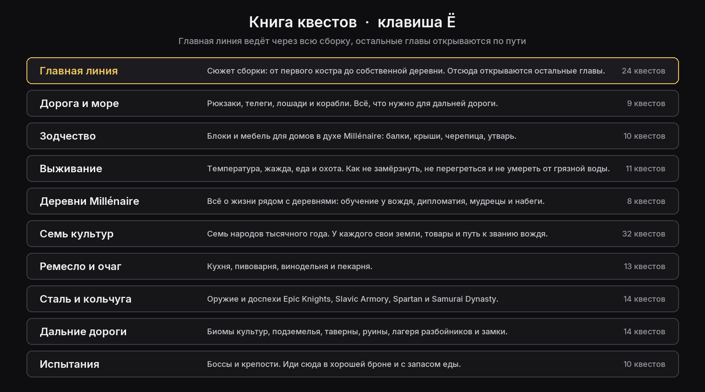
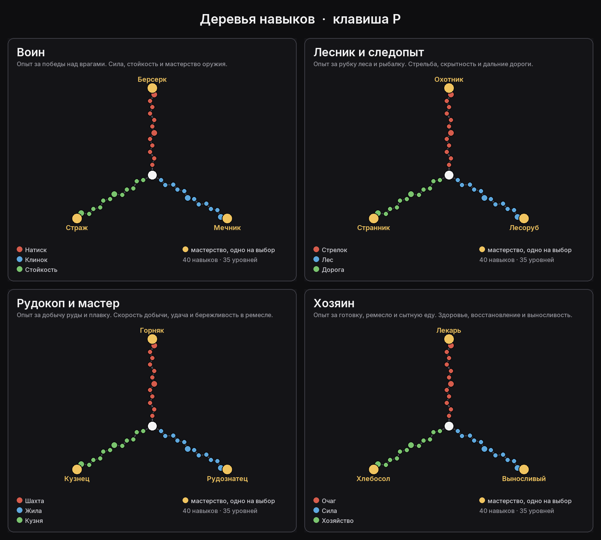

<p align="center">
  
</p>

<p align="center">
  <b>Minecraft 1.21.1 · NeoForge 21.1.264 · 185 модов · одиночная игра</b><br>
  <a href="#установка">Установка</a> ·
  <a href="docs/HOTKEYS.md">Клавиши</a> ·
  <a href="docs/MODLIST.md">Список модов</a> ·
  <a href="#если-что-то-пошло-не-так">Если что-то пошло не так</a> ·
  <a href="#контакты">Контакты</a>
</p>

---

## О сборке

Anno Mille («год тысячный» по-латыни) собрана вокруг мода [Millénaire](https://www.millenaire.org/ru). В мире живут деревни XI века: норманны, византийцы, сельджуки, индийцы, японцы, майя и инуиты. Жители работают, строят дома, торгуют и иногда просят о помощи. Если заслужишь их доверие, сможешь основать собственную деревню.

Всё остальное в сборке подобрано под эту эпоху. Здесь нет техники, огнестрела и яркой магии. Есть кольчуги и ламеллярные доспехи, корабли и телеги, холодные ночи и дорогая сталь.

Сборка не для лёгкой прогулки. Дерево не добыть кулаком, без тёплой одежды в горах замёрзнешь, грязная вода травит, а монстры со временем становятся сильнее. Прокачка рассчитана примерно на двести часов игры.

## Что внутри

<p align="center">
  
  
</p>

**Деревни Millénaire.** Семь культур, у каждой свои дома, товары и ремёсла. Репутация растёт от торговли, заданий и пожертвований. С высокой репутацией вождь учит тебя местным культурам и разрешает основать свою деревню.

**Выживание всерьёз.** Температура тела (Cold Sweat), жажда (Thirst Was Taken), разнообразие еды (Spice of Life), смена сезонов (Serene Seasons). Первые инструменты делаются из камней, волокна и кремня (Survivalist Essentials), а деревья рубятся постепенно (TreeChop).

**Оружие и броня XI века.** Epic Knights, Slavic Armory, Spartan Weaponry и Samurai Dynasty. Удары с замахом и комбо добавляет Better Combat.

**Мир.** Рельеф Tectonic, подземелья YUNG's, таверны, руины, замки и лагеря разбойников. Ванильные деревни отключены, живут только поселения Millénaire.

**Дорога и быт.** Корабли Small Ships, телеги и плуг AstikorCarts, лошади SWEM, рюкзак, кухня Farmer's Delight, пивоварня, винодельня, пекарня, мебель и десятки строительных блоков.

**Атмосфера.** Шейдеры Complementary Reimagined, звуки природы, эхо в пещерах, падающие листья, дождь из частиц. Собственный тёмный интерфейс с живым фоном в главном меню.

## Квесты

<p align="center">
  
</p>

145 квестов в 10 главах, книга открывается клавишей <kbd>Ё</kbd>. Главная линия проведёт от первого костра до собственной деревни, а остальные главы открываются по ходу игры. В каждом квесте написано, что сделать и как. Рецепты сверены с самими модами.

## Навыки

<p align="center">
  
</p>

Окно навыков открывается клавишей <kbd>P</kbd>. Деревьев четыре, и каждое качается своим делом. Воин растёт от побед над врагами, Лесник и следопыт от рубки леса и рыбалки, Рудокоп и мастер от добычи руды и плавки, Хозяин от готовки и ремесла.

Прибавки маленькие, от одного до трёх процентов за навык. В каждом дереве 40 навыков и только 35 уровней, поэтому всё не возьмёшь. На концах веток стоят мастерства, и в каждом дереве можно выбрать только одно из них.

## Системные требования

| | Минимум | Рекомендуется |
|---|---|---|
| Процессор | 4 ядра, 3,5 ГГц | 6–8 ядер (Ryzen 5 5600 и новее) |
| Видеокарта | GTX 1660 / RX 5600 (без шейдеров) | RTX 3060 / RX 6700 XT и новее |
| Оперативная память | 16 ГБ (игре выделить 6 ГБ) | 32 ГБ (игре выделить 8 ГБ) |
| Место на диске | 3 ГБ | 5 ГБ на SSD |

На Ryzen 7 7800X3D и RTX 5070 в 1080p с шейдерами держится 165 кадров в секунду.

## Установка

Сначала скачай файл `Anno-Mille-1.0.0.mrpack` со страницы [Releases](../../releases) и сам репозиторий кнопкой **Code → Download ZIP**. Для второго способа понадобится [Python 3.10+](https://www.python.org/downloads/), при установке поставь галочку «Add Python to PATH».

### Способ 1. Prism Launcher, Modrinth App, ATLauncher

1. Импортируй `Anno-Mille-1.0.0.mrpack`. В Prism это «Добавить экземпляр → Импорт», в Modrinth App «+ → Import from file». Лаунчер сам поставит Minecraft 1.21.1, NeoForge и 187 файлов с Modrinth.
2. Несколько модов авторы выкладывают только на CurseForge и на сайте Millénaire, поэтому в `.mrpack` их нет. Это сам Millénaire, FTB Quests и FTB Chunks, лошади SWEM и текстуры Excalibur. Их докачает установщик. Открой папку экземпляра (в Prism правой кнопкой → «Папка», в Modrinth App «⋯ → Open folder») и найди ту, где лежит папка `mods`. В Prism это вложенная папка `minecraft`, в Modrinth App сама папка профиля. Затем выполни:
   ```
   python tools/install.py "путь\к\папке\minecraft" --extra-only
   ```
3. В настройках экземпляра выдели игре 8 ГБ памяти и запускай.

### Способ 2. Любой другой лаунчер: TLauncher, Millida, официальный и прочие

1. Создай в лаунчере профиль с Minecraft **1.21.1** и **NeoForge 21.1.264** и запусти его один раз до главного меню, чтобы лаунчер всё скачал.
2. Найди папку игры этого профиля, ту, где лежат `mods` и `config`. У TLauncher это `%APPDATA%\.minecraft`, у Millida `%APPDATA%\net.millida.launcher\minecraft\profiles\<имя профиля>`.
3. Распакуй архив репозитория и выполни в его папке:
   ```
   python tools/install.py "путь\к\папке\игры"
   ```
   Установщик скачает все моды из официальных источников и проверит их контрольные суммы. Потом разложит настройки, квесты, интерфейс и перекрасит окна модов в тёмный стиль. Если перекраска пропустилась, поставь библиотеку командой `pip install pillow` и запусти установщик ещё раз.
4. Выдели игре 8 ГБ памяти и запускай.

### Первый мир

Создай новый мир на сложности «Сложная». В старых мирах не будет камешков и веточек на земле, а деревни Millénaire появляются только в новых, ещё не исследованных землях.

## Если что-то пошло не так

**Игра вылетает при запуске.** Мод Crash Assistant покажет окно с причиной вылета. Чаще всего виновата нехватка памяти: проверь, что игре выделено 8 ГБ. Ещё одна причина: в папке `mods` лежат две версии одного мода. Оставь одну.

**Мало кадров.** Выключи шейдеры клавишей <kbd>K</kbd> или выбери пак полегче клавишей <kbd>O</kbd>, например BSL. Дальность прорисовки 12 чанков вместо 16 тоже сильно помогает.

**Не видно деревень.** Деревни появляются не ближе 250–500 блоков от точки появления и только в новых землях. Клавиша <kbd>V</kbd> показывает уже найденные.

**Названия квестов на английском или «Безымянный».** Проверь, что в папке `config/ftbquests/quests/lang` лежат файлы `ru_ru.snbt` и `en_us.snbt`. Если нет, запусти установщик ещё раз.

## Для тех, кто хочет поменять сборку

Всё, что сделано специально для Anno Mille, лежит в папке `tools` и собирается скриптами на Python.

| Что | Файл |
|---|---|
| Квесты: тексты и задания | `tools/quests/build_quests.py`, `tools/quests/texts_h.json` |
| Деревья навыков | `tools/ui/skills.py` |
| Тёмный интерфейс | `tools/ui/build.py` |
| Живой фон главного меню | `tools/ui/bg.py` |
| Мини-мод сборки (без ванильных деревень, теги структур, навыки) | `tools/build_minimod.py` |
| Список модов с точными версиями | `tools/manifest.txt` |
| Сборка `.mrpack` | `tools/build_mrpack.py` |

## Благодарности

Сборка держится на чужом труде. Спасибо авторам всех модов из [списка](docs/MODLIST.md), и отдельно Kinniken и команде Millénaire за мир, ради которого всё затевалось. Файлы модов здесь не хранятся: установщик скачивает их со страниц авторов, поэтому скачивания засчитываются им.

## Лицензия

Собственные файлы сборки (квесты, настройки, интерфейс, скрипты) распространяются по лицензии [MIT](LICENSE). Моды, ресурспаки и шейдеры принадлежат их авторам и распространяются на их условиях.

## Контакты

<!-- ✏️ КОНТАКТЫ: замени текст в квадратных скобках на свои данные, а лишние строки удали -->
- Telegram: @holidesuSXC
- Discord: h0lydesu
- Почта: holidesusxc@gmail.com
- Баги и предложения: [Issues](../../issues)
